# MLC Isometrische 3D-Heatmap-Bibliothek

[English Version / Englische Version](README.md)

> 🤖 **Du arbeitest mit einem KI-Assistenten?** Das Paket bringt einen Agent-Skill mit,
> **[SKILL.md](https://github.com/mlechner911/mlcheatmap/blob/main/skills/mlc-isometric-heatmap/SKILL.md)**, mit API, Stolperfallen und getesteten Beispielen, damit der Assistent
> mit dieser Bibliothek funktionierenden Code schreibt. Die Installation steht unter [KI-Unterstützte Entwicklung](#ki-unterstützte-entwicklung).

Eine leichtgewichtige, wiederverwendbare TypeScript-Bibliothek zur Erstellung hochwertiger, interaktiver isometrischer 3D-Heatmaps als reine Vektorgrafiken (SVG).

Im Gegensatz zu klassischen flachen 2D-Heatmaps projiziert diese Bibliothek Datenpunkte in den isometrischen Raum. Dabei werden anpassbare 3D-Formen (Quader, Zylinder und fließende Bänder) verwendet. Sie unterstützt Ladeanimationen, divergierende Farbschemata, absinkende negative Werte sowie die transparente Darstellung von Null-Werten (fehlenden Messdaten).

---

## Warum 3D-Isometrie?

Herkömmliche 2D-Heatmaps codieren Zahlenwerte **ausschließlich über Farbschemata**. Auf digitalen Bildschirmen funktioniert das hervorragend, im echten Leben stößt es jedoch an Grenzen:

1.  **Druck & Graustufen-Konvertierung**: Werden Berichte oder Dashboards in Schwarz-Weiß ausgedruckt oder kopiert, verschwimmen feine Farbnuancen zu identischen Grautönen. Die Daten sind auf Papier kaum noch unterscheidbar.
2.  **Farbenblindheit-Barrierefreiheit**: Für Personen mit Farbsehschwächen (z. B. Roter- oder Grüner-Sehschwäche) ist das Ablesen reiner Farbskalen oft sehr schwer.

Durch **3D-Höhe und Perspektive**:
*   Werden Werte doppelt codiert: über die **Farbnuance** und über die **physische Säulenhöhe**.
*   Bleiben relative Unterschiede auch in Graustufen oder im Schwarz-Weiß-Druck **sofort lesbar und unterscheidbar**.
*   Wird Barrierefreiheit sichergestellt, da das Ablesen nicht allein von der Farbwahrnehmung abhängt.

---

## Features

*   **Kalender aus Datumswerten**: Du übergibst Ereignisse mit Datum oder Zeitstempel, statt Spalten und Zeilen auszurechnen. Die Presets ordnen sie nach Wochentag und Woche, summieren, was zusammenfällt, und beschriften die Achsen.
*   **Flache Ansicht**: `view: 'flat'` zeichnet aus denselben Daten und Presets eine normale 2D-Heatmap, ohne 3D-Effekt.
*   **Reine Vektorgrafik (SVG)**: Wird direkt als SVG-String generiert. Extrem leichtgewichtig, unendlich skalierbar und einfach in HTML einzubetten oder per CSS zu stylen.
*   **Fünf 3D-Formen**:
    *   `prism`: Kantige, dreidimensionale Quadersäulen.
    *   `cylinder`: Runde 3D-Zylinder mit feinen Verläufen und Schattierungen.
    *   `ribbon`: Fließende, kontinuierliche 3D-Bänder (Kurven) mittels kubischer Splines.
    *   `flatribbon`: Ein schwebendes 3D-Band mit konstanter Stärke, das parallel zur Datenkurve verläuft.
    *   `mesh`: Ein zusammenhängendes 3D-Netz (Terrain) mit Lambert-Schattierung.
*   **Kompakte Daten-Struktur**: Klares MVC-Design mit einem eigenen Koordinaten-Datenmodell (`HeatmapGrid`) getrennt vom Rendering-Prozess.
*   **Flexible Achsenbeschriftungen**: Automatische Zentrierung, Ausrichtung und Abstände für Zeilen-/Spaltenbeschriftungen (vorne oder hinten positionierbar).
*   **Negative Werte (Täler & Gräben)**: Volle Unterstützung für negative Werte, die sich unter den Grid-Boden absenken, inklusive kontrastierender Divergenzfarben.
*   **Null-Wert-Transparenz**: Zellen mit `null` (fehlende Messdaten) werden als leerer Raum (nur Gitterlinien) dargestellt. Bänder sinken davor sanft ab und enden sauber.
*   **Interaktivität**: CSS-Load-Animationen mit staggered Delay (zeitlich versetzt nach Koordinaten) und integrierte Mouseover-Title-Tags für Tooltips.
*   **Agent-Skill**: Bringt eine getestete `SKILL.md` für KI-Assistenten mit, siehe [KI-Unterstützte Entwicklung](#ki-unterstützte-entwicklung).

---

## Installation & CDNs

### 1. Über npm
Installiere die Bibliothek lokal in deinem Projekt:

```bash
npm install mlc-isometric-heatmap
```

### 2. Über CDN (Browser-native ES6-Module)
Lade die Rendering-Engine direkt in modernen Browsern ohne Build-Tools:

```html
<script type="module">
  import { HeatmapGrid } from 'https://unpkg.com/mlc-isometric-heatmap@1.4.0/dist/index.es.js';

  const grid = new HeatmapGrid(5, 5);
  // ...
</script>
```

### 3. Über CDN (Klassische UMD-Globals)
Lade die Skripte synchron über Standard-HTML-Tags:

```html
<!-- Core Visuals Renderer -->
<script src="https://unpkg.com/mlc-isometric-heatmap@1.4.0/dist/index.umd.js"></script>

<!-- Optional Calendar Aggregators -->
<script src="https://unpkg.com/mlc-isometric-heatmap@1.4.0/dist/presets.umd.js"></script>

<script>
  // Zugriff über globale Variablen:
  const grid = new MlcIsometricHeatmap.HeatmapGrid(5, 5);
  const presets = MlcIsometricHeatmapPresets.presets;
</script>
```

---

## Erste Schritte

### 1. Nutzung des OOP Grid-Modells (Standard)
Instanziere ein Grid, fülle Koordinaten aus und rendere das SVG:

```typescript
// ES6-Modul-Import (Node/Bundler):
import { HeatmapGrid } from 'mlc-isometric-heatmap';

// Oder Browser-native ES6-Modul-CDN-Import:
// import { HeatmapGrid } from 'https://unpkg.com/mlc-isometric-heatmap@1.4.0/dist/index.es.js';

// 1. Grid erstellen (8 Spalten x 8 Zeilen)
const grid = new HeatmapGrid(8, 8);

// 2. Werte eintragen (Spalte, Zeile, Wert, Label)
grid.setCell(0, 0, 15, 'Montag Vormittag');
grid.setCell(1, 1, -10, 'Dienstag Tiefpunkt');
grid.setCell(2, 2, null, 'Keine Daten (wird transparent)');

// 3. Achsenbeschriftungen definieren
grid.colLabels = ['C0', 'C1', 'C2', 'C3', 'C4', 'C5', 'C6', 'C7'];
grid.rowLabels = ['R0', 'R1', 'R2', 'R3', 'R4', 'R5', 'R6', 'R7'];

// 4. In SVG-String rendern
const svg = grid.render({
  shape: 'prism',          // 'prism' | 'cylinder' | 'ribbon' | 'flatribbon'
  colorScheme: 'emerald',  // Farbschema wählen
  dark: false,             // Dark Mode aktivieren
  showGrid: true,          // Gitterlinien anzeigen
  opacity: 1.0,            // Opazität (0.1 bis 1.0)
});
```

### 2. Kalender aus Datumswerten

Du musst keine Spalten und Zeilen ausrechnen. Übergib deine Ereignisse mit Datum oder Zeitstempel, und die Presets ordnen sie nach Wochentag und Woche, summieren, was zusammenfällt, und beschriften die Achsen:

```typescript
import { presets } from 'mlc-isometric-heatmap/presets';

const svg = presets
  .aggregateCalendarMonth(
    [
      { date: '2026-09-01', value: 12 },
      { date: '2026-09-02', value: 7 },
    ],
    { year: 2026, month: 8 }, // Monate zählen ab 0, das ist also September
  )
  .render({ colorScheme: 'emerald' });
```

`date` und `timestamp` nehmen ein `Date`, einen Text wie `'2026-09-01'` oder `'2026-09-01T14:30:00Z'` oder Millisekunden seit 1970. Die Zellen folgen der Ortszeit. [Den Kalender im Playground ausprobieren](https://play.mlcgo.eu/isometric-heatmap/calendar-month).

| Preset | Zeigt | Ereignisse |
|---|---|---|
| `aggregateCalendarMonth` | Einen Monat wie ein Wandkalender | `{ date, value }` |
| `aggregateMonth` | Einen Monat, Wochen als Spalten | `{ date, value }` |
| `aggregateYear` | Ein Jahr, wie bei GitHub | `{ date, value }` |
| `aggregate24h` | Stunden je Wochentag | `{ timestamp, value }` |
| `aggregateSixMonthsDouble` | Sechs Monate, zwei Zeilen je Wochentag | `{ date, value, measurement? }` |

Alle Presets im Überblick. Sie sind optional und liegen deshalb in einem eigenen Unterpfad:

```typescript
// ES6-Modul-Imports (Node/Bundler):
import { renderHeatmap } from 'mlc-isometric-heatmap';
import { presets } from 'mlc-isometric-heatmap/presets';

// Oder Browser-native ES6-Modul-CDN-Imports:
// import { renderHeatmap } from 'https://unpkg.com/mlc-isometric-heatmap@1.4.0/dist/index.es.js';
// import { presets } from 'https://unpkg.com/mlc-isometric-heatmap@1.4.0/dist/presets.es.js';

// 1. Wöchentliche 24h-Ansicht (24 Spalten für Stunden x 7 Zeilen für Tage)
const events = [
  { timestamp: new Date('2026-06-09T10:15:00Z'), value: 5 },
  { timestamp: new Date('2026-06-09T15:30:00Z'), value: 20 }
];
const weeklyGrid = presets.aggregate24h(events, { startOfWeek: 1 });
const weeklySvg = weeklyGrid.render({ colorScheme: 'sky' });

// 2. Monatskalender (5 Wochen-Spalten x 7 Wochentage)
const days = [
  { date: '2026-06-09', value: 5 },
  { date: '2026-06-10', value: 20 }
];
const monthlyGrid = presets.aggregateMonth(days, { year: 2026, month: 5 }); // Juni

// 3. Jahresbeitrags-Grid (53 Wochen-Spalten x 7 Wochentage)
const yearlyGrid = presets.aggregateYear(days, { year: 2026 });
```

### 3. Flache Heatmap

Du brauchst eine normale Heatmap statt einer Landschaft? Ergänze `view: 'flat'`. Daten, Presets und Farben bleiben gleich:

```typescript
const svg = presets
  .aggregateCalendarMonth(days, { year: 2026, month: 8 })
  .render({ view: 'flat', colorScheme: 'emerald' });
```

Zeilen stehen links, Spalten oben; `labelPosition: 'front'` setzt die Spalten unter das Raster. Nur die Farbe trägt hier den Wert, die Lesbarkeit in Graustufen und für Farbenblinde der 3D-Ansicht fällt also weg. `shape`, `maxHeight`, `projectionAngle`, `labelMode`, `labelLift`, `showAxisWalls` und `heightGrid` haben keine Wirkung.

---

## Visualisierungsoptionen

Du kannst die Darstellung anpassen, indem du diese Einstellungen an `.render()` oder `renderHeatmap()` übergibst:

| Option | Typ | Standard | Beschreibung |
| :--- | :--- | :--- | :--- |
| `gridSize` | `number` | `16` | Seitenlänge jeder Grid-Zelle in Pixeln. |
| `gap` | `number` | `2` | Abstand zwischen benachbarten 3D-Elementen. |
| `maxHeight` | `number` | `40` | Maximale Höhe eines 3D-Balkens (für den Höchstwert) in Pixeln. |
| `colorScheme`| `string \| CustomColorScheme` | `'github'` | Presets: `'github'`, `'emerald'`, `'sky'`, `'coral'`, `'amber'`, `'purple'`, `'sunset'`, `'grayscale'`. |
| `dark` | `boolean` | `false` | Aktiviert die Dark-Mode-Farbvarianten. |
| `view` | `'isometric' \| 'flat'` | `'isometric'` | 3D-Formen oder eine normale 2D-Heatmap aus farbigen Zellen. |
| `shape` | `'prism' \| 'cylinder' \| 'ribbon' \| 'flatribbon' \| 'mesh'` | `'prism'` | Layout-Form. |
| `opacity` | `number` | `1.0` | Deckkraft der 3D-Objektkörper (0.1 bis 1.0). |
| `showGrid` | `boolean` | `true` | Zeigt die Boden-Gitterlinien im isometrischen Raum. |
| `valueDomain` | `{ min, max }` | Daten-Min/Max | Feste Werteskala für Höhen/Farben — dieselbe Domain für alle Composite-Blöcke hält Höhen vergleichbar. |
| `showAxis` | `boolean` | `false` | Basis-Achsenlinien mit Tick-Markierungen an den Label-Kanten. |
| `axisColor` / `axisWidth` / `axisTickLength` | `string` / `number` / `number` | Labelfarbe / `1` / `5` | Styling der Achsenlinien und Ticks. |
| `showAxisWalls` | `boolean` | `false` | Transluzente Rückwände (links + hinten) als Label-Hintergrund; Labels dahinter rendern dann im Vordergrund. |
| `axisWallHeight` / `axisWallColor` | `number` / `string` | `maxHeight` / Wand-Default | Wandhöhe und Füllfarbe. |
| `zeroColor` | `string` | `undefined` | Eigene Farbe für Elemente mit dem Wert 0. |
| `renderFlatZero` | `boolean` | `true` | Rendert eine flache 2D-Fliese für Nullwerte anstelle einer leeren Stelle. |
| `interactive` | `boolean` | `true` | Bettet mouseover Title-Tags für Tooltips ein. |
| `animated` | `boolean` | `true` | Aktiviert die zeitlich versetzten Lade-Animationen. |
| `projectionAngle` | `number` | `30` | Isometrischer Kamerawinkel in Grad (10° bis 60°). |
| `labelPosition` | `'behind' \| 'front'` | `'front'` | Position der Achsenbeschriftungen relativ zum Gitter. Hintere Labels können von hohen Säulen verdeckt werden. |
| `labelMode` | `'screen' \| 'axis'` | `'screen'` | `'axis'` dreht die Labels parallel zur benachbarten Rasterachse. Sie überlappen dann nicht, solange `gridSize * sin(2 * projectionAngle)` größer als die Schrift ist. |
| `colLabelInterval` / `rowLabelInterval` | `number \| 'auto'` | `1` | Jede n-te Zelle beschriften. `'auto'` lässt so viele Labels weg, dass keine überlappen. |
| `labelFontSize` | `number` | `9` | Schriftgröße der Achsenbeschriftungen in px. |
| `gridCells` | `'all' \| 'data'` | `'all'` | Bodenlinien für alle Zellen oder nur unter Zellen mit Wert. |
| `interpolateColors` | `boolean` | `false` | Aktiviert stufenlose Farbverläufe (RGB-Farbinterpolation). |
| `showRowLabels` | `boolean` | `true` | Schaltet die Sichtbarkeit der Zeilenbeschriftungen (Serientext) ein/aus. |
| `colLabelAngle` / `rowLabelAngle` | `number` | `0` | Drehung der Beschriftungen in Grad um den Ankerpunkt. Label-Anhebung: `labelLift` (px, Default `0`) setzt Labels auf die Wandoberkante; die Wand zieht Führungslinien zu jeder Gitterlinie. `rowLabelAngle: -30` richtet Tageslabels bei 30°-Projektion an der Zeilenachse aus. |
| `rowLabelStyle` | `RowLabelStyle` | `undefined` | Eigene Formatierung der Zeilenbeschriftungen (Hintergrund-Boxen, Farben, Padding, Schriftgröße). |

---

### RowLabelStyle-Optionen (Zeilenbeschriftungen)

Passe die Zeilentexte mithilfe des Konfigurationsobjekts `rowLabelStyle` detailliert an:

*   `show?: boolean`: Einfaches Ein- und Ausschalten der Beschriftung (Standard: `true`).
*   `fontSize?: number`: Schriftgröße in Pixeln (Standard: `9`).
*   `fontFamily?: string`: Schriftart (Standard: `'sans-serif'`).
*   `color?: string`: Textfarbe (Standard: Standardbeschriftungsfarbe des gewählten Themas).
*   `backgroundColor?: string`: Hintergrundfarbe des Textfelds (z. B. `'#2f3542'`). Wird dies ohne Textfarbe angegeben, wird automatisch eine kontraststarke Textfarbe (weiß auf dunklem Hintergrund, anthrazit auf hellem Hintergrund) ermittelt.
*   `backgroundOpacity?: number`: Deckkraft der Hintergrundbox (Standard: `0.8`).
*   `padding?: number`: Innenabstand (Padding) der Hintergrundbox in Pixeln (Standard: `4`).
*   `borderRadius?: number`: Eckenradius (Border Radius) der Hintergrundbox in Pixeln (Standard: `2`).

---

### ML-Showcase: 3D-Loss-Landscape

Unsere isometrische Engine spielt ihre Stärke bei kontinuierlichen mathematischen Flächen aus. Ein Beispiel ist das `loss-landscape`-Preset, das eine Optimierungsfläche modelliert, wie sie beim Training neuronaler Netze erkundet wird.

Mit `shape: 'mesh'` und `interpolateColors` rendert die Library eine parabelförmige 3D-Schüssel (Optimierungstal) direkt als pures SVG:

*   **Das Tal (Mitte):** optimaler Modellzustand, Loss nahe `0.0` (kühle, ruhige Farben).
*   **Die Hügel (Ränder):** Hochfehler-Zonen Richtung `1.0` (warme Farben).

```typescript
// Auszug aus dem demo/generator.js-Preset
{
  shape: 'mesh',
  interpolateColors: true,
  colorScheme: 'sunset', // kühle Mitte zu warmem Rand
  gridSize: 22,
  gap: 0,
  maxHeight: 60,
}
```

Vorschau neu erzeugen mit:

```bash
node demo/generator.js --preset=loss-landscape --color=sunset --angle=30 \
  --interpolate-colors --out=demo/output/loss_landscape_bowl_sunset_mesh.svg
# ... oder komplett: bash demo/generate.sh
```

## Visuelle Beispiele

Hier sind einige im Ordner `demo/output` vorgenerierte SVG-Grafiken, die die Features der Bibliothek demonstrieren:

*   **24h Timeline Gradient Demo (4 Shapes & Continuous Gradient)**:
  
*   **6-Month Split Timeline (Smooth Gradients)**:
  
*   **24h Double-Row Timeline**:
  *   
*   **3D-Oberflächennetz-Gelände (Hügellandschaft)** *(Hinweis: Das kreisförmige Loch in der Mitte stellt einen "See" aus absichtlichen `null`-Werten dar und demonstriert, wie fehlende Messdaten/Ausfälle als saubere Lücke im Gelände gerendert werden)*:
  *   
*   **Loss Landscape Bowl (10x10 ML optimization surface)**:
  *   

---

## KI-Unterstützte Entwicklung

Das Paket bringt unter `skills/mlc-isometric-heatmap/` einen Agent-Skill im Standardformat `SKILL.md` mit: ein kurzer Kern mit den Stolperfallen und Referenzdateien je Aufgabe. Er hilft Coding-Assistenten, mit dieser Bibliothek korrekten Code zu schreiben.

Bei Assistenten, die Skills unterstützen, etwa Claude Code, kopierst du den Ordner in deren Skill-Verzeichnis:

```sh
cp -r node_modules/mlc-isometric-heatmap/skills/mlc-isometric-heatmap .claude/skills/
```

Andere Werkzeuge können [SKILL.md](https://github.com/mlechner911/mlcheatmap/blob/main/skills/mlc-isometric-heatmap/SKILL.md) als normales Markdown lesen.

---

## Lizenz & Urheberrecht (License & Attribution)

Dieses Projekt ist unter den Bedingungen der **MIT-Lizenz** lizenziert.

Copyright (c) 2026 Michael Lechner

Die freie Verwendung, Modifikation und Weiterverbreitung dieser Software ist gestattet, vorausgesetzt, dass der obige Urheberrechtshinweis und dieser Erlaubnishinweis in allen Kopien oder wesentlichen Teilen der Software enthalten sind. Weitere Details findest du in der vollständigen Datei [LICENSE](LICENSE).
