# MLC Isometric 3D Heatmap Library

[Deutsche Version / German version](index.de.md)

> 🤖 **Working with an AI coding assistant?** The package ships an agent skill,
> **[SKILL.md](https://github.com/mlechner911/mlcheatmap/blob/main/skills/mlc-isometric-heatmap/SKILL.md)**, with the API, the traps and tested examples, so that the assistant
> writes working code with this library. See [AI-Assisted Development](#ai-assisted-development) to install it.

A lightweight, reusable TypeScript library to render high-quality, interactive 3D isometric heatmaps as pure vector SVG graphics.

Unlike traditional 2D grid heatmaps, this library projects data points into isometric space using customizable 3D shapes (Prisms, Cylinders, and Continuous Ribbons), supporting load animations, diverging color schemes, negative sinking values, and transparent representation of null (missing) data.

---

## Why 3D Isometric?

Traditional 2D grid heatmaps rely **entirely on color gradients** to encode numeric values. While this works well on active digital displays, it introduces critical limitations in real-world scenarios:

1.  **Printing & Grayscale Conversion**: When reports or dashboards are printed in black-and-white or photocopied into grayscale, distinct color gradients often compress into virtually identical gray levels. This makes it extremely difficult to distinguish between different values on paper.
2.  **Colorblind Accessibility**: For users with color vision deficiencies (e.g., deuteranopia or protanopia), reading multi-hue color charts can be highly challenging.

By introducing **3D height and perspective**:
*   Values are double-encoded: by **color hue** and **physical column height**.
*   When printed in black-and-white or viewed in grayscale, the relative differences remain **instantly readable and distinguishable** thanks to the column heights.
*   Accessibility is greatly enhanced as the structural shape does not rely solely on color perception.

---

## Features

*   **Calendars from Dates**: Pass events with a date or timestamp instead of working out columns and rows. Presets place them by weekday and week, sum what falls together and label the axes.
*   **Flat View**: `view: 'flat'` draws a standard 2D heatmap from the same data and presets, without the 3D effect.
*   **Pure Vector Graphics (SVG)**: Renders directly as SVG code. Fully responsive, lightweight, scalable, and easy to embed or style.
*   **Multiple 3D Shapes**:
    *   `prism`: Sharp 3D rectangular columns.
    *   `cylinder`: Smooth 3D cylindrical pillars with shading gradients.
    *   `ribbon`: Continuous flowing 3D bands (curves) using cubic splines, with closed side-caps.
    *   `flatribbon`: Floating 3D ribbon bands of constant thickness.
    *   `mesh`: 3D contiguous surface mesh (terrain) with Lambertian diffuse shading.
*   **Model-View Separation**: Clean OOP coordinate space data model (`HeatmapGrid`) separate from the rendering engine.
*   **Flexible Axis Labels**: Automatic centering, alignment, and spacing of row/column labels with support for front/back positioning.
*   **Negative Values (Valleys & Trenches)**: Full projection support for negative heights sinking below the grid floor with diverging color themes.
*   **Null Value Concept**: Transparent/empty rendering for `null` cells, showing only grid floor lines, with smooth boundary slope-downs for continuous ribbons.
*   **Interactive Features**: Built-in CSS load animations (staggered delay transitions) and hover title/tooltip hooks.
*   **Agent Skill**: Ships a tested `SKILL.md` for AI coding assistants, see [AI-Assisted Development](#ai-assisted-development).

---

## Installation & CDNs

### 1. Via npm
Install the library locally:

```bash
npm install mlc-isometric-heatmap
```

### 2. Via CDN (Browser Native ES Modules)
Load the rendering engine directly in modern browsers without build tools:

```html
<script type="module">
  import { HeatmapGrid } from 'https://unpkg.com/mlc-isometric-heatmap@1.4.0/dist/index.es.js';

  const grid = new HeatmapGrid(5, 5);
  // ...
</script>
```

### 3. Via CDN (Traditional UMD Globals)
Load scripts synchronously using standard HTML `<script>` tags:

```html
<!-- Core Visuals Renderer -->
<script src="https://unpkg.com/mlc-isometric-heatmap@1.4.0/dist/index.umd.js"></script>

<!-- Optional Calendar Aggregators -->
<script src="https://unpkg.com/mlc-isometric-heatmap@1.4.0/dist/presets.umd.js"></script>

<script>
  // Access elements on global window variables:
  const grid = new MlcIsometricHeatmap.HeatmapGrid(5, 5);
  const presets = MlcIsometricHeatmapPresets.presets;
</script>
```

---

## Getting Started

### 1. Basic Usage (OOP Grid Model)

The recommended approach is to use the `HeatmapGrid` class to define grid dimensions, insert data points (including `null` values), and render the SVG:

```typescript
// ES6 Module Import (Node/Bundlers):
import { HeatmapGrid } from 'mlc-isometric-heatmap';

// Or Browser-Native ES6 Module CDN Import:
// import { HeatmapGrid } from 'https://unpkg.com/mlc-isometric-heatmap@1.4.0/dist/index.es.js';

// Create an 8x8 coordinate grid
const grid = new HeatmapGrid(8, 8);

// Populate grid cells
grid.setCell(0, 0, 15, 'Monday morning activity');
grid.setCell(1, 1, -10, 'Tuesday dip');
grid.setCell(2, 2, null, 'No recorded data (renders transparent)');

// Set labels
grid.colLabels = ['C0', 'C1', 'C2', 'C3', 'C4', 'C5', 'C6', 'C7'];
grid.rowLabels = ['R0', 'R1', 'R2', 'R3', 'R4', 'R5', 'R6', 'R7'];

// Render to SVG string
const svg = grid.render({
  shape: 'prism',          // 'prism' | 'cylinder' | 'ribbon' | 'flatribbon'
  colorScheme: 'emerald',  // Preset theme name or custom color scheme object
  dark: false,             // Dark mode colors
  showGrid: true,          // Draw grid cell lines
  opacity: 1.0,            // Bar opacity (0.1 to 1.0)
});
```

### 2. Calendars from Dates

You don't have to work out columns and rows. Pass your events with a date or timestamp, and the presets place them by weekday and week, sum what falls together and label the axes:

```typescript
import { presets } from 'mlc-isometric-heatmap/presets';

const svg = presets
  .aggregateCalendarMonth(
    [
      { date: '2026-09-01', value: 12 },
      { date: '2026-09-02', value: 7 },
    ],
    { year: 2026, month: 8 }, // months count from 0, so this is September
  )
  .render({ colorScheme: 'emerald' });
```

`date` and `timestamp` take a `Date`, a string like `'2026-09-01'` or `'2026-09-01T14:30:00Z'`, or milliseconds since the epoch. Cells follow local time. [Try the calendar in the playground](https://play.mlcgo.eu/isometric-heatmap/calendar-month).

| Preset | Shows | Events |
|---|---|---|
| `aggregateCalendarMonth` | One month like a wall calendar | `{ date, value }` |
| `aggregateMonth` | One month, weeks as columns | `{ date, value }` |
| `aggregateYear` | One year, GitHub style | `{ date, value }` |
| `aggregate24h` | Hours per weekday | `{ timestamp, value }` |
| `aggregateSixMonthsDouble` | Six months, two rows per weekday | `{ date, value, measurement? }` |

All presets at a glance. They are optional, so they come from a separate subpath:

```typescript
// ES6 Module Imports (Node/Bundlers):
import { renderHeatmap } from 'mlc-isometric-heatmap';
import { presets } from 'mlc-isometric-heatmap/presets';

// Or Browser-Native ES6 Module CDN Imports:
// import { renderHeatmap } from 'https://unpkg.com/mlc-isometric-heatmap@1.4.0/dist/index.es.js';
// import { presets } from 'https://unpkg.com/mlc-isometric-heatmap@1.4.0/dist/presets.es.js';

// 1. Weekly 24h Grid (24 columns x 7 days)
const events = [
  { timestamp: new Date('2026-06-09T10:15:00Z'), value: 5 },
  { timestamp: new Date('2026-06-09T15:30:00Z'), value: 20 }
];
const weeklyGrid = presets.aggregate24h(events, { startOfWeek: 1 });
const weeklySvg = weeklyGrid.render({ colorScheme: 'sky' });

// 2. Monthly Calendar Grid (5 columns of weeks x 7 days of week)
const days = [
  { date: '2026-06-09', value: 5 },
  { date: '2026-06-10', value: 20 }
];
const monthlyGrid = presets.aggregateMonth(days, { year: 2026, month: 5 }); // June

// 3. GitHub Contribution Grid (53 columns of weeks x 7 days of week)
const yearlyGrid = presets.aggregateYear(days, { year: 2026 });
```

### 3. Flat Heatmap

Need a standard heatmap instead of a landscape? Add `view: 'flat'`. Data, presets and colors stay the same:

```typescript
const svg = presets
  .aggregateCalendarMonth(days, { year: 2026, month: 8 })
  .render({ view: 'flat', colorScheme: 'emerald' });
```

Rows sit on the left and columns on top; `labelPosition: 'front'` moves the columns below the grid. Only color carries the value here, so the chart loses the grayscale and colorblind readability of the 3D view. `shape`, `maxHeight`, `projectionAngle`, `labelMode`, `labelLift`, `showAxisWalls` and `heightGrid` have no effect.

---

## Render Options

Configure the output by passing these settings to `.render()` or `renderHeatmap()`:

| Option | Type | Default | Description |
| :--- | :--- | :--- | :--- |
| `gridSize` | `number` | `16` | Cell spacing/size in pixels. |
| `gap` | `number` | `2` | Spacing gap between adjacent 3D columns. |
| `maxHeight` | `number` | `40` | Maximum height of a 3D bar (for max value) in pixels. |
| `colorScheme`| `string \| CustomColorScheme` | `'github'` | Presets: `'github'`, `'emerald'`, `'sky'`, `'coral'`, `'amber'`, `'purple'`, `'sunset'`, `'grayscale'`. |
| `dark` | `boolean` | `false` | Enable dark theme color schemes. |
| `view` | `'isometric' \| 'flat'` | `'isometric'` | 3D shapes, or a standard 2D heatmap of colored cells. |
| `shape` | `'prism' \| 'cylinder' \| 'ribbon' \| 'flatribbon' \| 'mesh'` | `'prism'` | Visual layout style. |
| `opacity` | `number` | `1.0` | Opacity value from `0.1` to `1.0`. |
| `showGrid` | `boolean` | `true` | Show isometric grid floor layout lines. |
| `valueDomain` | `{ min, max }` | data min/max | Fixed value domain for height/color scaling — same domain for every composite block keeps heights comparable. |
| `showAxis` | `boolean` | `false` | Baseline axis rules with tick marks along the label edges. |
| `axisColor` / `axisWidth` / `axisTickLength` | `string` / `number` / `number` | label color / `1` / `5` | Axis rule/tick styling. |
| `showAxisWalls` | `boolean` | `false` | Translucent back walls (left + behind) as label backdrop; behind-labels render in foreground when on. |
| `axisWallHeight` / `axisWallColor` | `number` / `string` | `maxHeight` / wall default | Wall height and fill color. |
| `zeroColor` | `string` | `undefined` | Override color of zero-value cells. |
| `renderFlatZero` | `boolean` | `true` | Renders a flat 2D plate for zero values instead of a blank space. |
| `interactive` | `boolean` | `true` | Embed interactive tooltips and hover scaling. |
| `animated` | `boolean` | `true` | Enables staggered load animations. |
| `projectionAngle` | `number` | `30` | Isometric camera angle in degrees (10° to 60°). |
| `labelPosition` | `'behind' \| 'front'` | `'front'` | Render row/column labels at the back or front of the grid projection. Rear labels can be hidden by tall bars. |
| `labelMode` | `'screen' \| 'axis'` | `'screen'` | `'axis'` rotates labels to run along the neighbouring grid axis, so parallel labels stay clear of each other while `gridSize * sin(2 * projectionAngle)` exceeds the font size. |
| `colLabelInterval` / `rowLabelInterval` | `number \| 'auto'` | `1` | Label every nth cell. `'auto'` drops as many labels as needed to avoid overlaps. |
| `labelFontSize` | `number` | `9` | Font size of axis labels in px. |
| `gridCells` | `'all' \| 'data'` | `'all'` | Draw floor lines for every cell or only under cells with a value. |
| `showRowLabels` | `boolean` | `true` | Toggle visibility of row labels (series annotations). |
| `colLabelAngle` / `rowLabelAngle` | `number` | `0` | Label rotation in degrees about the anchor. Label uplift: `labelLift` (px, default `0`) seats labels on top of axis walls; walls draw ruling lines from each label down to its grid line. `rowLabelAngle: -30` aligns day labels with the row axis at 30° projection. |
| `rowLabelStyle` | `RowLabelStyle` | `undefined` | Custom styling for row labels (colors, background boxes, padding, radius, font size). |

---

### RowLabelStyle Settings

Customize row/series text annotations using the `rowLabelStyle` configuration object:

*   `show?: boolean`: Easy toggle to turn off label rendering (default: `true`).
*   `fontSize?: number`: Font size in pixels (default: `9`).
*   `fontFamily?: string`: Custom font family (default: `'sans-serif'`).
*   `color?: string`: Font text color (default: theme default label color).
*   `backgroundColor?: string`: Backdrop rect fill color (e.g., `'#2f3542'`). If specified without a text `color`, a high-contrast text color is automatically resolved (white on dark backgrounds, slate on light backgrounds).
*   `backgroundOpacity?: number`: Opacity of the background box (default: `0.8`).
*   `padding?: number`: Padding spacing inside the background box (default: `4`).
*   `borderRadius?: number`: Corner border radius of the background box (default: `2`).

---

---

### ML Showcase: 3D Loss Landscape

Our isometric engine shines when visualizing continuous mathematical surfaces. A prime example is the `loss-landscape` preset, which models an optimization surface typically explored during neural network training.

Using `shape: 'mesh'` combined with `interpolateColors`, the library renders a 3D parabolic bowl (optimization valley) directly into pure SVG:

*   **The Valley (Center):** the optimal model state with a loss value near `0.0` (cool, calm colors).
*   **The Hills (Edges):** high-error zones approaching `1.0` (warm colors).

```typescript
// Excerpt from the demo/generator.js preset
{
  shape: 'mesh',
  interpolateColors: true,
  colorScheme: 'sunset', // cool center to warm rim
  gridSize: 22,
  gap: 0,
  maxHeight: 60,
}
```

Regenerate the preview with:

```bash
node demo/generator.js --preset=loss-landscape --color=sunset --angle=30 \
  --interpolate-colors --out=demo/output/loss_landscape_bowl_sunset_mesh.svg
# ... or the full batch: bash demo/generate.sh
```

## Visual Examples

Here are some pre-rendered SVG examples demonstrating the library's capabilities:

*   **24h Timeline Gradient Demo (4 Shapes & Continuous Gradient)**:
  
*   **6-Month Split Timeline (Smooth Gradients)**:
  
*   **24h Double-Row Timeline**:
  *   
*   **3D Surface Mesh Terrain (Rolling Hills)** *(Note: The circular hole in the center represents a "lake" of intentional `null` values, demonstrating how missing/outage data is rendered as a clean gap in the terrain)*:
  *   
*   **Loss Landscape Bowl (10x10 ML optimization surface)**:
  *   

## AI-Assisted Development

The package ships an agent skill at `skills/mlc-isometric-heatmap/`, in the standard `SKILL.md` format: a short core with the traps, plus reference files for each task. It helps coding assistants write correct code with this library.

To use it with an assistant that supports skills, such as Claude Code, copy the folder into its skills directory:

```sh
cp -r node_modules/mlc-isometric-heatmap/skills/mlc-isometric-heatmap .claude/skills/
```

Other tools can read [SKILL.md](https://github.com/mlechner911/mlcheatmap/blob/main/skills/mlc-isometric-heatmap/SKILL.md) as plain Markdown.

---

## License & Attribution

This project is licensed under the terms of the **MIT License**.

Copyright (c) 2026 Michael Lechner

You are free to use, modify, and distribute this software, provided that the above copyright notice and this permission notice are included in all copies or substantial portions of the software. For more details, see the full [LICENSE](LICENSE) file.
